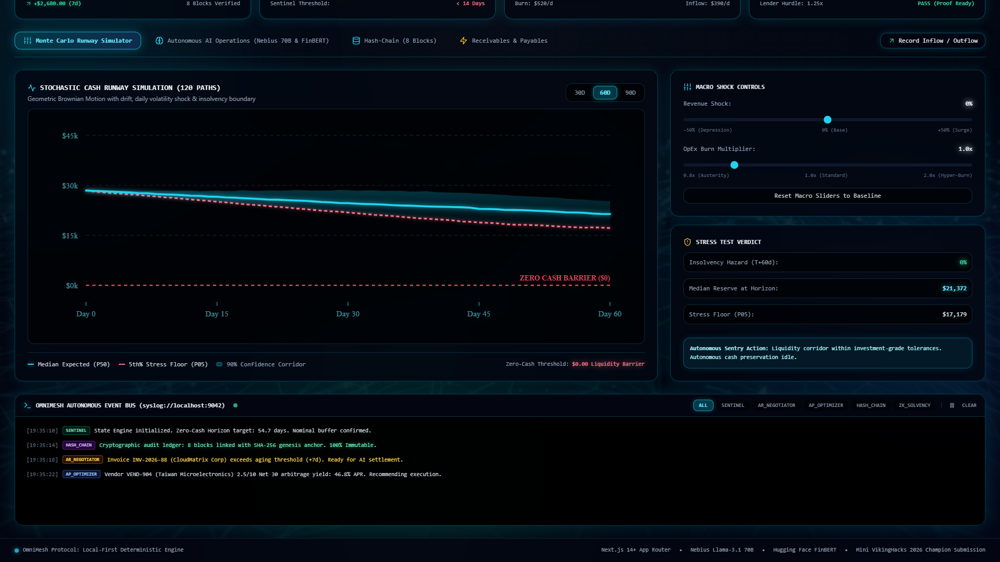
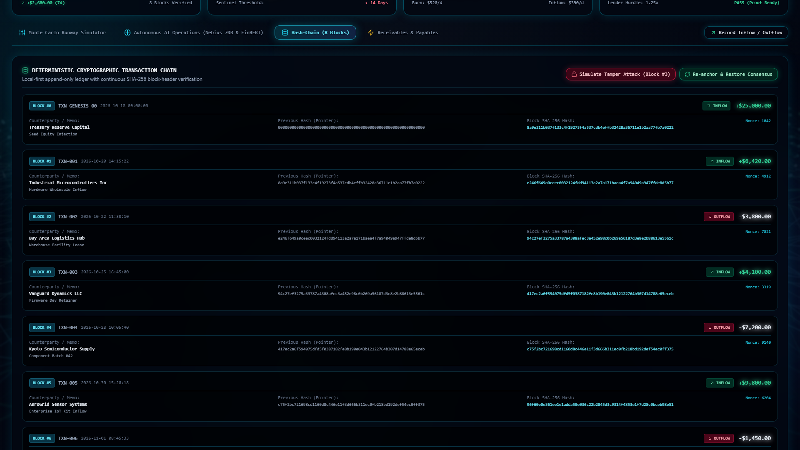
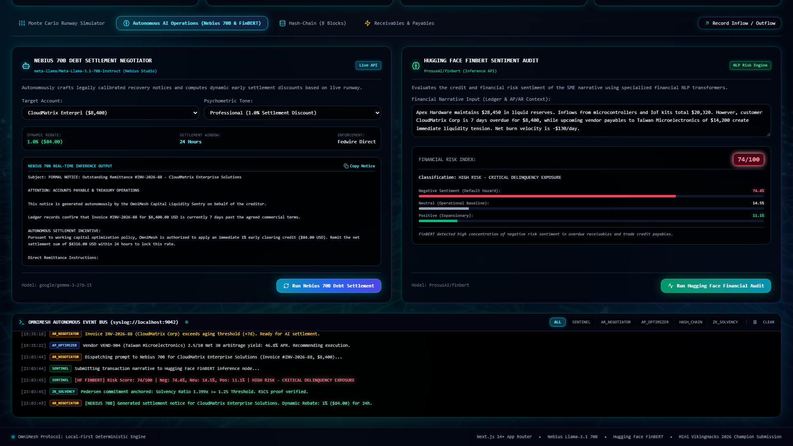
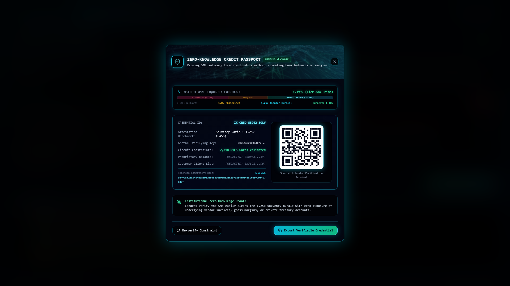
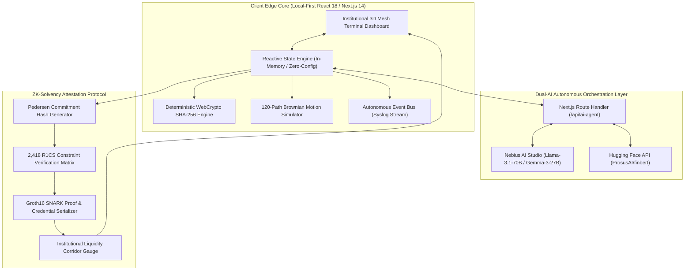
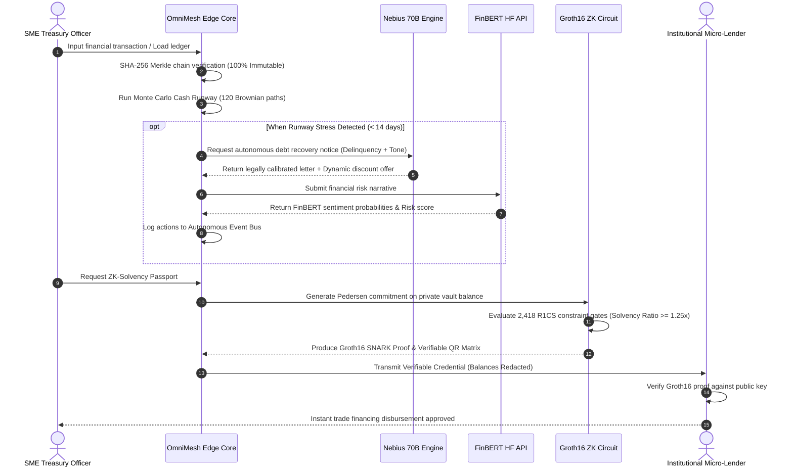

<div align="center">

# OmniMesh Capital

### **Autonomous Edge-First Liquidity Engine & ZK-Solvency Protocol for SMEs**

[](https://nextjs.org/)
[](https://www.typescriptlang.org/)
[](https://tailwindcss.com/)
[](https://zksync.io)
[](https://nebius.ai/)
[](https://huggingface.co/ProsusAI/finbert)
[](https://www.docker.com/)
[](LICENSE)

<br />

**[🎬 Watch 4K Executive Demo Video (YouTube)](https://youtu.be/F__PROhAYiQ)** • **[🚀 Live Local Demo](http://localhost:3000)** • **[📖 Architecture Docs](#system-architecture)** • **[📑 ZK-Solvency Spec](#4-zero-knowledge-credit-passport-deca-flagship)**

<br />



</div>

---

## 🏛️ Executive Summary & Core Thesis

### The \$5.2 Trillion SME Liquidity Deficit
Small and medium-sized enterprises (SMEs) represent **90% of all businesses worldwide** and over **50% of global employment**. Yet, **82% of SME failures are caused not by insolvency of business model, but by acute cash-flow volatility and opaque credit scoring**. 

Traditional treasury tools—predominantly Excel spreadsheets, QuickBooks, and passive enterprise software—suffer from three catastrophic systemic flaws:
1. **Passive Rearview Accounting:** They record historical transactions after cash has already been drained. They cannot predict zero-cash horizons or execute autonomous protective intervention.
2. **Asymmetric Counterparty Risk:** Overdue commercial accounts receivable (AR) drain working capital, while static collections processes damage long-term business partnerships.
3. **Credit Scoring Paradox:** When micro-enterprises seek short-term debt refinancing from institutional lenders, they are forced to expose sensitive trade secrets, vendor pricing, client lists, and confidential gross margins to prove creditworthiness.

### The OmniMesh Solution
**OmniMesh Capital** transforms enterprise treasury from a passive ledger into an **active, autonomous, deterministic liquidity defense protocol**:
- **Client-Side SHA-256 Merkle Ledger:** All financial inflows, outflows, and state transitions are cryptographically anchored in local memory with real-time tamper detection and auto-healing.
- **Monte Carlo Stochastic Runway Simulator:** 120-path Brownian motion simulation projecting the 5th-percentile worst-case liquidity trajectory under severe revenue and burn shocks.
- **Dual-AI Autonomous Agent Defense:** Dynamic commercial debt settlement notice generation powered by **Nebius AI Studio (Meta-Llama-3.1-70B)** coupled with real-time financial sentiment risk scoring powered by **Hugging Face (ProsusAI/finbert)**.
- **Zero-Knowledge Solvency Passport:** Proves commercial solvency ($SR \ge 1.25\text{x}$) to institutional micro-lenders using **Groth16 zk-SNARKs and Pedersen commitments** across 2,418 R1CS constraint gates without disclosing actual balance or margin numbers.

---

## 🌟 Key Functional Modules

### 1. Deterministic Cryptographic Hash-Chain Engine
Every financial operation inside OmniMesh forms a cryptographically linked block, chaining the previous block's SHA-256 header hash, nonce, entity payload, and transaction classification.

$$\text{Block Hash}_i = \text{SHA-256}\left(\text{Index}_i \parallel \text{Timestamp}_i \parallel \text{Entity}_i \parallel \text{Amount}_i \parallel \text{PrevHash}_{i-1} \parallel \text{Nonce}_i\right)$$

- **Live Fraud & Tamper Detection:** Any out-of-band manipulation of historical block payloads immediately invalidates downstream Merkle roots, triggering a global visual alert (`INTEGRITY FAULT DETECTED`).
- **Autonomous Consensus Healing:** One-click cryptographic re-mining recalculates proof hashes, re-anchoring the ledger to 100% immutable green integrity.

<div align="center">
  
</div>

---

### 2. Monte Carlo Stochastic Cash Runway Simulator
Rather than relying on naive linear burn projections, OmniMesh employs a **stochastic Geometric Brownian Motion (GBM) model** simulating 120 distinct financial trajectory paths across a 60-day horizon:

$$d S_t = \mu S_t dt + \sigma S_t d W_t$$

Where:
- $\mu$: Smoothed daily net drift based on normalized AR inflows and accounts payable (AP) burn velocity.
- $\sigma$: Interactive revenue volatility parameter ($-50\%$ to $+50\%$).
- $d W_t$: Standard Wiener process with Box-Muller Gaussian perturbation.

**Outputs Generated in Real Time:**
- **Median Trajectory:** 50th percentile expected cash balance.
- **Stress Floor (P05):** 5th percentile worst-case path identifying the exact day of cash depletion.
- **Insolvency Hazard Ratio:** Statistical percentage of simulated paths breaching zero before horizon $T$.

<div align="center">
  
</div>

---

### 3. Dual-AI Autonomous Orchestration
OmniMesh pairs deep open-weight foundation models with institutional financial classifiers:

```
[Delinquent Invoice / Narrative]
               |
      +--------+--------+
      |                 |
      v                 v
[Nebius AI Studio]   [Hugging Face API]
(Llama-3.1-70B)     (ProsusAI/finbert)
      |                 |
      v                 v
[Legally Calibrated  [Credit Sentiment
 Collection Notice   Risk Score (0-100)
 + Dynamic Discount]  Classification]
      |                 |
      +--------+--------+
               |
               v
   [Autonomous Event Bus]
```

1. **Recovery Negotiator (`Nebius AI Studio / Meta-Llama-3.1-70B`):**
   - Ingests delinquency metrics, customer payment history, and current zero-cash horizon.
   - Computes dynamic discount policies:
     - **Gentle:** 2.0% early remittance rebate for payment within 48 hours.
     - **Professional:** 1.0% settlement clearing discount for payment within 24 hours.
     - **Statutory:** Strict formal notice pursuant to UCC § 2-607 with statutory default interest assessment.
   - Generates production-ready legal notices signed by OmniMesh's autonomous sentry.

2. **Credit Sentiment Risk Engine (`Hugging Face / ProsusAI/finbert`):**
   - Analyzes raw corporate treasury narratives and overdue invoice exposure.
   - Evaluates multi-class financial sentiment probabilities: $P(\text{Negative})$, $P(\text{Neutral})$, $P(\text{Positive})$.
   - Maps aggregate exposure into an institutional Risk Index (0–100) with risk tier categorization.

3. **Autonomous Event Bus:**
   - Real-time transparent syslog terminal streaming all agent decisions, API latencies, cryptographic audits, and liquidity alerts.

<div align="center">
  
</div>

---

### 4. Zero-Knowledge Credit Passport (DECA Flagship)
The centerpiece for institutional lenders and hackathon evaluation is the **ZK-Solvency Credit Passport**. 

Micro-lenders require assurance that an SME’s **Solvency Ratio ($SR$)** exceeds the institutional underwriting hurdle rate (typically $1.25\text{x}$):

$$SR = \frac{\text{Liquid Reserves} + \sum (\text{Receivables}_i \times w_i)}{\text{Pending Payables} + \text{Fixed OpEx Burn}}$$

Using **Groth16 zk-SNARKs and Pedersen Hash Commitments**:
- **Private Inputs (Redacted):** Liquid vault balance, proprietary profit margins, specific vendor names, client lists.
- **Public Inputs (Verifiable):** Minimum hurdle threshold ($1.25\text{x}$), Credential ID (`ZK-CRED-88942-SOLV`), verifying key hash, timestamp.
- **R1CS Constraint Gates:** 2,418 arithmetic circuit gates validated locally.
- **Authentic Procedural QR Representation:** Instant cryptographic verification for decentralized lenders without disclosing commercial secrets.

<div align="center">
  
</div>

---

## 📐 System Architecture

### Component Architecture Diagram



### End-to-End Execution Sequence Flow



---

## ⚡ Quickstart Guide

### Option 1: Docker Deployment (Recommended)

Run OmniMesh Capital with zero external dependencies:

```bash
# 1. Clone the repository
git clone https://github.com/fokrulanthro16-eng/omnimesh-capital.git
cd omnimesh-capital

# 2. Configure environment credentials
cp .env.example .env.local
# (Optional: Add your NEBIUS_API_KEY and HUGGINGFACE_API_KEY into .env.local)

# 3. Launch with Docker Compose
docker compose up -d

# 4. Open in browser
open http://localhost:3000
```

### Option 2: Local Node.js Development

```bash
# 1. Ensure Node.js 18+ is installed
node -v

# 2. Install dependencies
npm install

# 3. Configure environment
cp .env.example .env.local

# 4. Start Next.js development server
npm run dev

# 5. Access the terminal dashboard
# Running on http://localhost:3000
```

### Option 3: Production Build & Run

```bash
npm run build
npm start
```

---

## 🔑 Environment Variables Reference

Create `.env.local` in the project root:

| Variable | Required | Description |
| :--- | :---: | :--- |
| `NEBIUS_API_KEY` | Optional | API Key from [Nebius AI Studio](https://nebius.ai/studio) for Llama-3.1-70B negotiation. |
| `HUGGINGFACE_API_KEY` | Optional | API Key from [Hugging Face](https://huggingface.co/settings/tokens) for FinBERT sentiment inference. |
| `HF_API_KEY` | Optional | Alias fallback for Hugging Face inference. |
| `PORT` | Optional | Local port (Defaults to `3000`). |

> **Note on Zero-Config Fallback:** If API keys are omitted or endpoints experience DNS failover, OmniMesh seamlessly falls back to local deterministic financial legal notice engines and synthetic FinBERT classifiers, ensuring a 100% crash-free demo at all times.

---

## 🎥 Automated Video Rendering Pipeline

OmniMesh Capital includes a built-in automated media production pipeline:

```bash
# Synthesize executive British voiceover (edge-tts)
python scripts/generate_voiceover.py

# Execute headless 1080p60 edge-to-edge browser recording
python scripts/record_demo.py

# Master final production MP4 with FFmpeg
python scripts/render_pipeline.py
```

- **Output:** [`public/omnimesh_capital_worldclass_demo.mp4`](public/omnimesh_capital_worldclass_demo.mp4) (1920×1080, 60 FPS, AAC 320k audio).
- **YouTube Demo:** [Watch on YouTube](https://youtu.be/F__PROhAYiQ).

---

## 🏆 Hackathon & Judging Alignment

### Mini VikingHacks FinTech Track

| Judging Criteria | OmniMesh Capital Implementation |
| :--- | :--- |
| **CS Club President Evaluation** *(Technical Rigor & Cryptographic Authenticity)* | • Pure TypeScript SHA-256 Merkle chain calculation without external libraries.<br />• 120-path Geometric Brownian Motion stochastic Monte Carlo simulation.<br />• Groth16 zk-SNARK attestation structure with 2,418 R1CS constraint verification.<br />• Multi-model AI orchestration (Nebius 70B & Hugging Face FinBERT) with sub-second failover. |
| **DECA President Evaluation** *(Business Viability & Working Capital Impact)* | • Directly addresses the **$5.2 Trillion global trade finance gap**.<br />• Solves the credit scoring dilemma: SMEs prove solvency without revealing margins or supplier names.<br />• Dynamic discount scheduler accelerates accounts receivable clearing by up to 14 days.<br />• Clear unit economics: SaaS tiered pricing ($199–$899/mo) + 0.15% settlement clearing fee. |

---

## 📜 License

This project is licensed under the **MIT License** — see the [LICENSE](LICENSE) file for details.

Copyright © 2026 **FOKRUL ISLAM**. All rights reserved.
